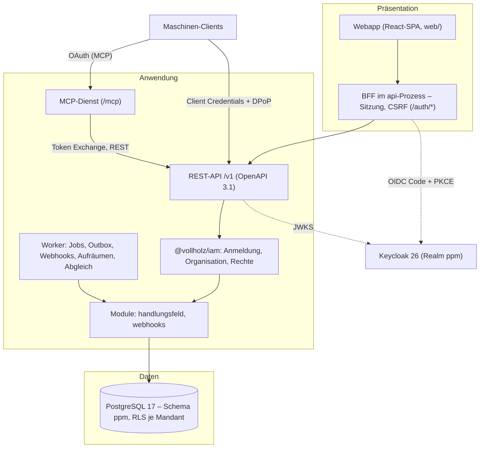

# Zielarchitektur

PPM ist eine mandantenfähige App für Strategieumsetzung und Projektportfoliomanagement. Dieses Dokument beschreibt das
technische Grundgerüst: Leitentscheidungen, Schichten, Prozesse, Modulgrenzen und wie ein neues Modul entsteht.

> Herkunft: Das technische Gerüst (Querschnitt über `@vollholz/platform`, Build, CI, Betrieb, Prüfungen) folgt der
> Vorlage des [identity-kit](https://github.com/vollholz/identity-kit) (`docs/neue-app.md`, Konzept App-Plattform).
> Fachlich gilt nur die Spezifikation in diesem Repository.

## Zweck und Anforderungen

Fachlich führt das [Masterdokument](PPM-Master.md) mit [Funktionsbaum](anhang/funktionsbaum.md),
[Use Cases](anhang/use-cases.md) und der [UX-Schicht](ux/README.md):

| Business-Modul | Inhalt |
|---|---|
| ZM Zielmanagement | Handlungsfelder, strategische Ziele, Jahresziele, Zielerreichung, Quartalsreporting |
| DM Demand Management | Projektideen, Projektvertrag |
| PP Portfolioplanung | Bewertung, Priorisierung, Szenarien, Portfolioentscheide |
| PS Portfoliosteuerung | Statusberichte, Phasen und Gates, Änderungen und Eskalationen, Abschluss, Stakeholder |
| PC Portfoliocontrolling | Finanzen, Risiken, Nutzen und KPIs, Reporting |
| RK Ressourcen und Kapazitäten | Kapazitätsangebot, Bedarf und Zuteilung |
| AM Application Management | Benutzer und Berechtigungen, Stammdaten, Vorlagen, Schnittstellen, Protokoll |

Das Gerüst enthält davon nur das Beispielmodul **Handlungsfelder** (BC ZM.01.01, Stammdaten aus Etappe E0 im
[Fahrplan](ux/fahrplan.md)) und das Modul **Webhooks** (BC AM.03.02, Profil outbox). Die Module entstehen in den
Etappen des Fahrplans nach dem Bauplan [fachmodell.md](fachmodell.md) (Modulschnitt, Arbeitspakete). Querschnittliche Anforderungen: mehrere Organisationen in einer Datenbank mit harter Trennung,
Anmeldung über Keycloak (auch Microsoft Entra ID je Organisation), Maschinenzugriff und MCP, Nachvollziehbarkeit
(Audit), Betrieb in einem Image.

## Leitentscheidungen

| # | Entscheidung | Umsetzung |
|---|---|---|
| L1 | Drei Schichten: Präsentation (SPA + BFF) · Anwendung (API, Worker, MCP) · Daten (PostgreSQL) | [Schichten](#schichten) |
| L2 | Ein Codebestand, mehrere Prozesse, ein Image; TypeScript auf Node 24 ohne Build-Schritt (Type Stripping) | `Dockerfile`, `deploy/docker-entrypoint.sh` |
| L3 | Mandant = Organisation in Keycloak 26; genau eine Organisation je Anfrage | `@vollholz/iam` (`PrincipalResolver`) |
| L4 | Die Datenbank erzwingt die Mandantentrennung (RLS `FORCE`); Laufzeit-Rolle ohne `BYPASSRLS`, besitzt keine Tabelle | `db/bootstrap.sql`, [mandantentrennung.md](mandantentrennung.md) |
| L5 | Eine Berechtigungslogik für Oberfläche, API, Maschinen und MCP | `src/authz/model.ts`, `iamPlugin` (über `@vollholz/platform`) |
| L6 | Standards statt Eigenbau: OIDC/OAuth 2.1, OpenAPI 3.1, RFC 9457, CloudEvents, Standard Webhooks, MCP, OpenTelemetry | [api.md](api.md), [mcp.md](mcp.md) |
| L7 | Modularer Monolith mit maschinell geprüften Grenzen | `.dependency-cruiser.cjs`, [Modulgrenzen](#modulgrenzen) |
| L8 | Konfiguration nur über Umgebungsvariablen, eine Liste als Quelle, Exit 78 bei Fehlern | `app.vars` (IAM, `@vollholz/platform`, App), [konfiguration.md](konfiguration.md) |
| L9 | Browser nur same-origin; Drittsysteme erreicht nur das Backend über erlaubte Netz-Adapter | `scripts/check-network.ts` |
| L10 | Deutsch, Schweizer Rechtschreibung (ohne Eszett), Oberfläche mit Anrede «Sie» (UX-E7, bis zur Klärung von UX-OF-1) | `scripts/check-address.ts`, `web/src/ui/texts.test.ts` |

## Schichten



- **Präsentation:** Die SPA liefert der `api`-Prozess aus (`uiModule` aus `@vollholz/platform`). Tokens bleiben auf dem
  Server; der Browser hat nur ein Sitzungs-Cookie, schreibende Aufrufe tragen ein CSRF-Token.
- **Anwendung:** Fastify mit Querschnitt aus `@vollholz/platform` (`defineApp` in `src/app.ts`) und eingehängten Modulen. Der MCP-Dienst ist ein
  Client der REST-API, keine zweite Fachlogik.
- **Daten:** eine Datenbank, `tenant_id` an jedem Datensatz, Migrationen als eigene Besitzer-Rolle.

## Prozesse

Ein Image, Startbefehl als Argument ([betrieb.md](betrieb.md#prozesse-und-startbefehle)):

| Befehl | Einstieg | Port | Aufgabe |
|---|---|---|---|
| `api` | `src/cli.ts api` | 8080 | REST-API, Doku `/v1/docs`, BFF, Webapp |
| `worker` | `src/cli.ts worker` | – | Warteschlange, Outbox, Webhooks, Aufräumen, Mitgliederabgleich |
| `mcp` | `src/cli.ts mcp` | 8081 | MCP über Streamable HTTP |
| `migrate` | `src/cli.ts migrate` | – | Migrationen von Baukasten, Plattform und App |
| `tenant` | `src/cli.ts tenant …` | – | Organisationen auflisten, anlegen, sperren, entsperren, löschen |
| `rotate-keys` | `src/cli.ts rotate-keys` | – | Hauptschlüssel rotieren |

Prozesse und Befehle kommen aus `@vollholz/platform` (`runCli`). Jeder Dienst hat den Betriebs-Endpunkt auf `OPS_PORT`
(9090). Die Zusammensetzung steht in `src/app.ts` (`defineApp`, auch für Tests, Skripte und den OpenAPI-Export).

## Querschnitt aus @vollholz/platform

Konfiguration, HTTP (Fastify, OpenAPI, Rate-Limit, Idempotenz, CSP, Oberfläche), Warteschlange und Outbox, Betrieb
(Telemetrie, Metriken, geordnetes Beenden), MCP-Dienst, Mandanten und Rotation liefert das Paket `@vollholz/platform`
(identity-kit). Die App hat davon nur noch:

- `src/platform.ts`: `definePlatform` mit Modell und Ressourcen; gebundene Bausteine für die Module (`record`,
  `enqueue`, `emit`, `fullTx`, `seal`, `unseal`, `reseal`).
- `src/app.ts`: `defineApp` mit den Modulen und den Migrationen. Warteschlange, Idempotenz und Outbox legt die
  Migration `platform_001_core.sql` des Pakets an, vor den Migrationen der App.
- `src/cli.ts`: Startbefehl (`runCli`).

## Modulgrenzen

```text
cli.ts → app.ts                Kompositionswurzel (Prozesse, Befehle)
  └── modules/<x>/index.ts     öffentliche Schnittstelle eines Moduls
        └── modules/<x>/*      intern
platform.ts                    gebundene Bausteine für Module (record, enqueue, seal …)
  └── authz/ product.ts        Modell, Ressourcen, Name und Schema
```

Geprüft mit `npm run arch` (dependency-cruiser):

| Regel | Inhalt | Begründung |
|---|---|---|
| `keine-zyklen` | keine Zyklen, auch über `import type` | Module bleiben einzeln herauslösbar |
| `kein-test-im-code` | produktiver Code importiert nichts aus `test/` | Testhilfen nie im Image |
| `modul-nur-ueber-index` | ein Modul nutzt ein anderes nur über dessen `index.ts` | stabile, kleine Schnittstellen |
| `von-aussen-nur-ueber-index` | ausserhalb der Module nur `modules/<x>/index.ts` | Interna bleiben intern |
| `module-kennen-keine-wurzel` | Module importieren weder `app.ts` noch `cli.ts` | Richtung: die Wurzel setzt Module zusammen; Bausteine kommen aus `platform.ts` |
| `basis-ohne-module` | `platform.ts`, `product.ts`, `authz/` kennen weder Module noch Wurzel | Basis ohne Wissen über Fachliches |
| `querschnitt-nur-oeffentlich` | von `@vollholz/platform` nur `@vollholz/platform` und `/preload` | Interna des Pakets können sich ändern |
| `feature-nur-gemeinsame-bausteine` | Features der Webapp nutzen keine anderen Features (Ausnahmeliste anfangs leer) | Features unabhängig |
| `feature-ohne-shell-und-router` | Features kennen Shell, Router und Einstieg nicht | Navigation über Suchparameter |
| `basis-ohne-features` | `ui/`, `api/`, `auth/`, `styles/` kennen keine Features | gemeinsame Bausteine bleiben neutral |

Zusätzlich in `npm run arch`: `scripts/check-network.ts` (Netz nur in eingetragenen Adaptern, Webapp nur
same-origin) und `scripts/check-address.ts` (keine Du-Form, Schweizer Rechtschreibung). Unterschiede zur Vorlage:
`HttpError` kommt aus `@vollholz/platform`; Fachjobs gehören als `JobDefinition` ins Modul (`defineModule`). Neue Ausnahmen
nur mit TODO, Begründung und Eintrag hier.

## Checkliste «Neues Modul anlegen»

0. Vor dem Modul: Schnitt, Tabellen, Rechte, Migrationsbereich und Besitz des Arbeitspakets im Bauplan
   [fachmodell.md](fachmodell.md) nachschlagen (verbindlich; Stand in [umsetzungsstand.md](umsetzungsstand.md)).
   Business Cases und Use Cases im [Funktionsbaum](anhang/funktionsbaum.md) bzw. in den
   [Use Cases](anhang/use-cases.md), bei Oberfläche den Kernablauf in [ux/ablaeufe/](ux/ablaeufe/) lesen. Keine
   Regel bauen, die dort fehlt (`[OFFEN]` bleibt offen; es gilt die Annahme `A-nn` aus dem Bauplan).
1. Ordner `src/modules/<x>/` mit `index.ts` als einziger öffentlicher Schnittstelle (Muster: `modules/handlungsfeld/`:
   `index.ts` mit `defineModule` – Tag, Routen, MCP-Werkzeuge, bei Bedarf Jobs –, `routes.ts`, `store.ts`,
   `schemas.ts`, `mcp.ts`).
2. Eintrag in `src/app.ts` (`modules`). Aufgaben, Outbox-Abnehmer und Rotation von Geheimnissen gehören ins
   `defineModule` des Moduls (Muster: `modules/webhooks/index.ts`).
3. Andere Module nur über deren `index.ts` nutzen. Braucht Infrastruktur etwas vom Modul: Richtung umdrehen
   (das Modul registriert sich), nicht importieren.
4. Generisches (Schemas, Cursor, ETag, Audit) kommt aus `@vollholz/platform` bzw. `src/platform.ts`, nie ins Modul;
   fehlt etwas, gehört es ins Paket (identity-kit).
5. Tabellen in einer neuen Migration `db/migrations/NNN_<x>.sql` (Nummer aus dem Bereich des Arbeitspakets): `tenant_id` zuerst im Primärschlüssel und in
   Indizes, `SELECT app.secure_tenant_tables()`, Policies der Lesesicht (ohne Typ im Modell mit
   `app.has_permission('<recht>')` wie `001_handlungsfeld.sql`, mit Typ über `app.read_all()`, `app.has_tuple(…)`), `GRANT` nur an `ppm_app` bzw.
   `_sched`; jede Tabelle mit Testdaten in die Matrix von `test/app/rls.test.ts` (`TENANT_TABLES`, `POLICIES`).
6. Jede Route mit Fall in `test/app/tenant-isolation.test.ts` (`CASES`); Tag des Moduls in `APP_TAGS` dort.
7. Genau ein Tag je Route, Tag in `tags` des Moduls (`defineModule`).
8. Rechte, Rollen, Scopes und ggf. Typ im Modell `src/authz/model.ts`, danach
   `npm run identity:platform-json`; neuer Typ: Kette und `exists` in `src/authz/resources.ts`.
9. Oberfläche: Feature-Ordner `web/src/features/<x>/` mit `index.ts`, Eintrag in `web/src/router.tsx` und
   `web/src/search.ts`, Adresse im Arbeitsraum nach [ux/informationsarchitektur.md](ux/informationsarchitektur.md);
   UX-Definition of Done nach [ux/rahmen/pruefung.md](ux/rahmen/pruefung.md); danach `npm run openapi:export && npm run api:types`.
10. `npm run check` grün.

## Offene Entscheidungen

Siehe [offene-punkte.md](offene-punkte.md).
