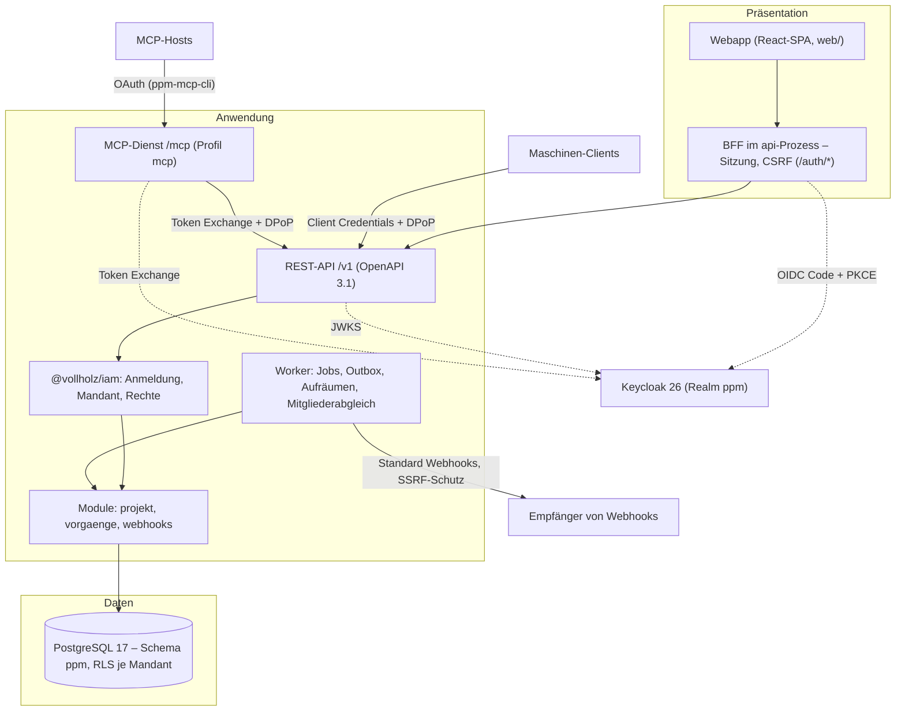

# Zielarchitektur

PPM ist eine mandantenfähige App für Strategieumsetzung und Projektportfoliomanagement. Dieses Dokument beschreibt das
**Grundgerüst** (Boilerplate-Spezifikation, abgeleitet aus Assets): Anforderungen, Leitentscheidungen, Schichten,
Prozesse, Modulgrenzen und die Checkliste für neue Module. Die Fachlichkeit steht in [PPM-Master.md](PPM-Master.md).

## Anforderungen und Zweck

| Anforderung | Umsetzung |
|---|---|
| Lokal lauffähig ohne Handarbeit | `npm ci`, `npm run web:install`, `npm run dev:setup`, `npm run web:build`, `npm run dev:api` ([einrichtung.md](einrichtung.md)) |
| Mehrere Organisationen in einer Installation, streng getrennt | Mandant = Organisation in Keycloak, RLS in PostgreSQL ([mandantentrennung.md](mandantentrennung.md)) |
| Eine Berechtigungslogik für Oberfläche, API, Maschinen und MCP | `@vollholz/iam` mit dem Modell [`src/platform/authz/model.ts`](../src/platform/authz/model.ts) |
| Ein Image, mehrere Prozesse | [`Dockerfile`](../Dockerfile), [`deploy/docker-entrypoint.sh`](../deploy/docker-entrypoint.sh) ([betrieb.md](betrieb.md)) |
| Erste Fachfunktion als Modul, ohne das Gerüst zu ändern | Checkliste [«Neues Modul anlegen»](#checkliste-neues-modul-anlegen) |
| Prüfbare Qualität | `npm run check` (Typen, Modulgrenzen, Tests, Webapp), CI ([betrieb.md › CI](betrieb.md#ci)) |

**Parameter des Gerüsts**

| Parameter | Wert |
|---|---|
| Technischer Name, Datenbank-Präfix, Schema | `ppm` |
| Anzeigename | PPM |
| Öffentliche Adresse | `https://ppm.project-suite.ch` |
| Keycloak | `https://id.project-suite.ch`, Realm `ppm` |
| Beispielmodul | `projekt` (Routen `/v1/projekte`) |
| Profile | `mcp`, `outbox` (mit Modul `webhooks`) |
| Deployment | Hetzner, bestehendes Projekt ([`deploy/hetzner/README.md`](../deploy/hetzner/README.md)) |

## Leitentscheidungen

| # | Entscheidung | Umsetzung in PPM |
|---|---|---|
| L1 | **Drei Schichten:** Präsentation (SPA + BFF) · Anwendung (API, Worker, MCP) · Daten (PostgreSQL) | [`web/`](../web), [`src/platform/main/`](../src/platform/main), [`db/`](../db); Diagramm unten |
| L2 | **Ein Codebestand, mehrere Prozesse, ein Image.** TypeScript auf Node 24 mit Type Stripping, kein Build-Schritt im Backend | [`Dockerfile`](../Dockerfile) (Stufen `deps` → `check` → `web` → `prod-deps` → `runtime`), [`deploy/docker-entrypoint.sh`](../deploy/docker-entrypoint.sh) |
| L3 | **Mandant = Organisation in Keycloak 26.** Genau eine Organisation je Anfrage, Wechsel ausdrücklich (Header `X-Tenant` je Tab) | `@vollholz/iam` (`iamPlugin` in [`http/app.ts`](../src/platform/http/app.ts)), Claim `organization` (`TENANT_CLAIM`) |
| L4 | **Die Datenbank erzwingt die Mandantentrennung (RLS).** Laufzeit-Rollen ohne `BYPASSRLS`, besitzen keine Tabelle | [`db/bootstrap.sql`](../db/bootstrap.sql), `app.secure_tenant_tables()` in jeder Migration, [`test/platform/rls.test.ts`](../test/platform/rls.test.ts) |
| L5 | **Eine Berechtigungslogik für alle Zugänge** aus `@vollholz/iam` | `createIam` in [`main/compose.ts`](../src/platform/main/compose.ts), `req.need`/`req.capabilities` in den Routen, `McpAuth` im MCP-Dienst |
| L6 | **Standards statt Eigenbau:** OIDC/OAuth 2.1, OpenAPI 3.1, RFC 9457, CloudEvents + Standard Webhooks, MCP, OpenTelemetry | [`http/app.ts`](../src/platform/http/app.ts), [`core/events.ts`](../src/platform/core/events.ts), [`modules/webhooks/sign.ts`](../src/platform/modules/webhooks/sign.ts), [`mcp/server.ts`](../src/platform/mcp/server.ts), [`ops/telemetry.ts`](../src/platform/ops/telemetry.ts) |
| L7 | **Modularer Monolith mit maschinell geprüften Grenzen** | [`.dependency-cruiser.cjs`](../.dependency-cruiser.cjs), `npm run arch` |
| L8 | **Konfiguration nur über Umgebungsvariablen**, eine Liste als einzige Quelle, Exit 78 bei Fehlern | [`config/env.ts`](../src/platform/config/env.ts) (`VARS = IAM_VARS('ppm') + APP_VARS`), `npm run env:docs` → [konfiguration.md](konfiguration.md) |
| L9 | **Browser nur same-origin.** Drittsysteme erreicht nur das Backend über erlaubte Netz-Adapter | [`scripts/check-network.ts`](../scripts/check-network.ts), CSP `connect-src 'self'` in [`modules/auth/ui.ts`](../src/platform/modules/auth/ui.ts) |
| L10 | **Sprache:** Deutsch, Schweizer Rechtschreibung ohne Eszett, Oberfläche in Du-Form, sichtbar «Organisation» | [`scripts/check-address.ts`](../scripts/check-address.ts), [`web/src/ui/texts.test.ts`](../web/src/ui/texts.test.ts) |

## Schichten



- **Präsentation:** Die SPA liefert der `api`-Prozess aus ([`modules/auth/ui.ts`](../src/platform/modules/auth/ui.ts)).
  Tokens bleiben auf dem Server; der Browser hat nur ein `HttpOnly`-Cookie, schreibende Aufrufe tragen
  `X-CSRF-Token`. Aufbau: [oberflaeche.md](oberflaeche.md).
- **Anwendung:** `buildApp` ([`http/app.ts`](../src/platform/http/app.ts)) bringt den Querschnitt (Logs mit
  Redaction, Request-ID, Helmet, CSP, Rate-Limit, OpenAPI, problem+json, Idempotenz, Metriken); die Module hängen
  sich über `Module.register` ein. Der MCP-Dienst ist ein **Client der REST-API**, keine zweite Fachlogik.
- **Daten:** eine Datenbank für alle Mandanten, `tenant_id` an jedem Datensatz, RLS `FORCE`, Migrationen mit der
  Besitzer-Rolle `ppm_owner`.

## Prozesse

Ein Image, der Startbefehl ist das erste Argument. Details, Ports und Geheimnisse: [betrieb.md](betrieb.md).

| Befehl | Einstieg | Aufgabe |
|---|---|---|
| `api` | [`main/api.ts`](../src/platform/main/api.ts) | REST-API, BFF, Webapp, OpenAPI |
| `worker` | [`main/worker.ts`](../src/platform/main/worker.ts) | Warteschlange, Outbox, Aufräumen, Mitgliederabgleich |
| `mcp` | [`main/mcp.ts`](../src/platform/main/mcp.ts) | MCP über Streamable HTTP ([mcp.md](mcp.md)) |
| `migrate` | [`scripts/db-migrate.ts`](../scripts/db-migrate.ts) | Migrationen von `@vollholz/iam` und der App |
| `tenant` | [`scripts/tenant-admin.ts`](../scripts/tenant-admin.ts) | Mandanten auflisten, anlegen, sperren, entsperren, löschen |
| `rotate-keys` | [`scripts/rotate-encryption-keys.ts`](../scripts/rotate-encryption-keys.ts) | Hauptschlüssel rotieren |
| `healthcheck` | Entrypoint | `HEALTHCHECK` des Images über den Betriebs-Endpunkt |

Die Kompositionswurzel der API ist `createApi` in [`main/compose.ts`](../src/platform/main/compose.ts); dieselbe
Funktion nutzen der Prozess, die Tests (Mock-IdP, Wegwerf-Datenbank) und der OpenAPI-Export.

## Bausteine

| Ordner | Inhalt |
|---|---|
| [`config/`](../src/platform/config) | `env.ts`: Variablenliste, Prüfung, `PlatformConfig`, `loadOrExit` (Exit 78) |
| [`db/`](../src/platform/db) | `pool.ts` (`createPool`, `withTx`, `withTenant` mit `SET LOCAL`), `migrate.ts` (Modell als Parameter) |
| [`core/`](../src/platform/core) | `errors.ts` (`HttpError` aus `@vollholz/iam`, 412/428), `audit.ts`, `crypto.ts` (Umschlagverschlüsselung), `events.ts` (`emit`, CloudEvents), `redact.ts`, `ssrf.ts`, `shared-state.ts` |
| [`auth/`](../src/platform/auth) | `principal.ts` (`actorOf`), `tokens.ts` |
| [`authz/`](../src/platform/authz) | `model.ts` (Rechte, Rollen, Scopes, Orte, MCP-Werkzeuge), `resources.ts` (Kette `org` → `projekt`, Klassifizierung), `view.ts` (`fullTx`) |
| [`http/`](../src/platform/http) | `app.ts` (`buildApp`, `Deps`, `Module`, `API_TAGS`, `API_CSP`), `route-kit.ts`, `idempotency.ts` |
| [`ops/`](../src/platform/ops) | `preload.ts`, `server.ts` (Betriebs-Endpunkt), `runtime.ts` (Beenden), `telemetry.ts`, `metrics.ts`, `tenants.ts`, `rotation.ts` |
| [`worker/`](../src/platform/worker) | `queue.ts` (`Worker`, `enqueue`, `JobDefinition`, `PeriodicTask`), `outbox.ts`, `member-sync.ts`, `retention.ts` |
| [`mcp/`](../src/platform/mcp) | `server.ts`, `api.ts`, `exchange.ts`, `dpop.ts`, `tools.ts` |
| [`modules/`](../src/platform/modules) | `index.ts` (`MODULES`, `OUTBOX_CONSUMERS`, `ROTATIONS`), `jobs.ts` (`JOBS`, `TASKS`), `auth/` (Webapp), `projekt/`, `vorgaenge/`, `webhooks/` |

**Rollenmodell** ([`authz/model.ts`](../src/platform/authz/model.ts)):

| Rolle | Ort | Rechte |
|---|---|---|
| `org-admin` | `org` | alle (vom Baukasten ergänzt, inkl. `tenant:*`, `members:admin`, `access:admin`, `audit:read`, `webhook:admin`) |
| `editor` | `org`, `projekt` | `tenant:read`, `projekt:read`, `projekt:write`, `projekt:delete`, `access:admin` |
| `viewer` | `org`, `projekt` | `tenant:read`, `projekt:read` |
| `auditor` | `org` | `tenant:read`, `projekt:read`, `audit:read` |

Scopes für Maschinen: `ppm:read` (`tenant:read`, `projekt:read`) und `projekt:write` (`projekt:write`,
`projekt:delete`). `webhook:admin` hat `scope: false` (nur Personen). Effektiv gilt **Rolle ∩ Scope**.
`platform-admin` ist eine Realm-Rolle ohne Mitgliedschaft in einer Organisation.

## Modulgrenzen

```text
main/                         Kompositionswurzeln
  ├── modules/index.ts, modules/jobs.ts
  │     └── modules/<x>/index.ts   öffentliche Schnittstelle
  │           └── modules/<x>/*    intern
  ├── mcp/                     nur REST, keine Module (ausser Typen), keine Datenbank
  └── http/ auth/ authz/ ops/ worker/   Infrastruktur, kennt keine Module
        └── core/ db/ config/          Basis
```

Regeln aus [`.dependency-cruiser.cjs`](../.dependency-cruiser.cjs), geprüft mit `npm run arch`:

| Regel | Bedeutung |
|---|---|
| `keine-zyklen` | Keine Zyklen, auch nicht über `import type` |
| `kein-test-im-code` | Produktiver Code importiert keine Tests |
| `modul-nur-ueber-index` | Ein Modul nutzt ein anderes nur über dessen `index.ts` |
| `von-aussen-nur-ueber-index` | Ausserhalb von `modules/` nur über `modules/<x>/index.ts`, `modules/index.ts` oder `modules/jobs.ts` |
| `module-kennen-keine-prozesse` | Module importieren nichts aus `main/` |
| `core-ohne-module` | `core/`, `db/`, `config/` kennen keine Module |
| `core-ist-basis` | `core/`, `db/`, `config/` kennen keine Infrastruktur und keine Prozesse |
| `infrastruktur-ohne-module` | `http/`, `auth/`, `authz/`, `ops/`, `worker/` kennen weder Module noch `main/` noch `mcp/` (Richtung umdrehen: Module registrieren sich) |
| `mcp-nur-rest` | `mcp/` importiert keine Module, kein `db/`, `worker/`, `http/` und kein `pg` (Typen erlaubt) |
| `feature-nur-gemeinsame-bausteine` | Features der Webapp nutzen keine anderen Features (keine Ausnahmen) |
| `feature-ohne-shell-und-router` | Features kennen `shell/`, `router.tsx` und `app.tsx` nicht |
| `basis-ohne-features` | `ui/`, `api/`, `auth/`, `styles/` der Webapp kennen keine Features |

Folgerungen: `db/` kennt kein `authz/` – darum liegt `fullTx` in [`authz/view.ts`](../src/platform/authz/view.ts) und
`runMigrations(url, model)` bekommt das Modell als Parameter. `HttpError` liegt in
[`core/errors.ts`](../src/platform/core/errors.ts) (Re-Export aus `@vollholz/iam`). Fachjobs gehören als
`JobDefinition` ins Modul (z. B. [`modules/projekt/jobs.ts`](../src/platform/modules/projekt/jobs.ts)), nicht nach
`worker/`. Es gibt **keine Ausnahmen**; neue nur mit TODO, Begründung und Eintrag hier.

**Netz-Adapter** ([`scripts/check-network.ts`](../scripts/check-network.ts) › `NETWORK_ADAPTERS`): Nur diese
Dateien dürfen `fetch`, `node:http(s)`, `node:net`, `node:tls` oder `undici` nutzen.

| Datei | Begründung |
|---|---|
| [`src/platform/ops/server.ts`](../src/platform/ops/server.ts) | Betriebs-Endpunkt (`/healthz`, `/readyz`, `/metrics`) auf `OPS_PORT` |
| [`src/platform/core/ssrf.ts`](../src/platform/core/ssrf.ts) | Ausgehende Abrufe an Adressen aus Daten (Webhooks) mit SSRF-Schutz und fester Gesamtfrist |
| [`src/platform/mcp/server.ts`](../src/platform/mcp/server.ts) | MCP-Dienst: eigener HTTP-Server und Bereitschaftsprüfung der REST-API; Aufrufe der API nur über `ApiClient` aus `@vollholz/iam` |

Abrufe von Keycloak und Microsoft (Discovery, JWKS, Admin-API, Token Exchange) macht `@vollholz/iam` selbst. Die
Webapp nutzt keine absoluten Adressen; `web/dist/index.html` lädt nichts von aussen (beides prüft dasselbe Skript).

## Checkliste «Neues Modul anlegen»

Beispiel: Modul `portfolio`. Vorlage ist das Modul [`projekt`](../src/platform/modules/projekt) (Backend) bzw.
[`web/src/features/projekt`](../web/src/features/projekt) (Webapp).

**Backend**

1. Ordner `src/platform/modules/portfolio/` mit **`index.ts`** als einziger öffentlicher Schnittstelle
   (`export const portfolioModule: Module = { name: 'portfolio', register }`), intern `routes.ts`, `store.ts`,
   `schemas.ts`, bei Bedarf `jobs.ts`.
2. Eintrag in [`modules/index.ts`](../src/platform/modules/index.ts) (`MODULES` vor `uiModule`, das als SPA-Fallback
   zuletzt bleibt; bei Bedarf `OUTBOX_CONSUMERS`, `ROTATIONS`) und in [`modules/jobs.ts`](../src/platform/modules/jobs.ts)
   (`JOBS`, `TASKS`).
3. Andere Module **nur über deren `index.ts`** nutzen. Braucht Infrastruktur (`http/`, `worker/` …) etwas vom Modul,
   **Richtung umdrehen statt importieren**: das Modul registriert sich (Routen, `JobDefinition`, `OutboxConsumer`,
   `Rotation`).
4. **Generisches** (Schemas, Cursor, ETag, Hilfen ohne Fachbezug) nach [`http/route-kit.ts`](../src/platform/http/route-kit.ts)
   bzw. `core/`, nicht in ein Modul.
5. Migration `db/migrations/NNN_portfolio.sql` (nur vorwärts): jede Tabelle mit `tenant_id uuid NOT NULL` zuerst in
   Primärschlüssel und Indizes, am Ende `SELECT app.secure_tenant_tables();` (RLS `ENABLE` + `FORCE`, Policy
   `tenant_isolation`), restriktive Policies der Lesesicht (`app.read_all()`, `app.has_tuple()`, `app.clearance()` …),
   Rechte nur an `ppm_app` bzw. `ppm_sched`. Geheimnisse nur mit Umschlagverschlüsselung
   ([`core/crypto.ts`](../src/platform/core/crypto.ts)) und Eintrag in `ROTATIONS`.
6. Jede neue Tabelle in die **`MATRIX`** von [`test/platform/rls.test.ts`](../test/platform/rls.test.ts) (Testdaten,
   ggf. `sched`, `appendOnly`) – sonst schlägt «jede Tabelle ist abgedeckt» fehl. Tabellen mit Mandantendaten auch in
   `APP_TENANT_TABLES` in [`ops/tenants.ts`](../src/platform/ops/tenants.ts) (Löschen eines Mandanten).
7. Fälle in [`test/platform/tenant-isolation.test.ts`](../test/platform/tenant-isolation.test.ts): Routen mit
   fremder ID in `FOREIGN`, Listen in `LISTS`, Anlegen in `CREATE` – sonst meldet die Vollständigkeitsprüfung die
   Route.
8. Rechte, Rollen, Scopes, Ort und ggf. MCP-Werkzeuge in [`authz/model.ts`](../src/platform/authz/model.ts), danach
   **`npm run identity:platform-json`** (erzeugt [`infra/keycloak/platform.json`](../infra/keycloak/platform.json)).
9. Neuer Ort (Typ) in [`authz/resources.ts`](../src/platform/authz/resources.ts) (`TABLES`, bei Klassifizierung
   `CLASSIFIED`; Typ mit Eltern: eigene Kette nach identity-kit `docs/neue-app.md` › Ressourcen).
10. **Ein Tag je Route**: Tag in [`API_TAGS`](../src/platform/http/app.ts) eintragen, jede Route nennt genau diesen
    einen (Test in `problems.test.ts`). Schemas als benannte Komponenten (`$id`, `Type.Ref`).
11. Tests des Moduls `test/platform/portfolio.test.ts` (CRUD, ETag/412, Idempotenz, Rechte inkl. Scope,
    Klassifizierung, Audit).

**Webapp**

12. Feature-Ordner `web/src/features/portfolio/` mit `index.ts` als Schnittstelle; nur gemeinsame Bausteine
    (`ui/`, `api/`, `auth/`) nutzen, keine anderen Features, nicht Shell oder Router.
13. Route und Einträge in Navigation/Befehlspalette in [`web/src/router.tsx`](../web/src/router.tsx) (`SHELL`),
    Suchparameter in [`web/src/search.ts`](../web/src/search.ts).
14. **`npm run api:types`** (OpenAPI-Export + `web/src/api/schema.d.ts`).

**Abschluss**

15. **`npm run check`** grün (Typen, `arch`, Tests, `web:check`).

Ausserhalb dieser Dateien (`modules/index.ts`, `modules/jobs.ts`, `db/migrations/`, `rls.test.ts`,
`tenant-isolation.test.ts`, `ops/tenants.ts`, `authz/model.ts`, `authz/resources.ts`, `infra/keycloak/platform.json`,
`API_TAGS`, `router.tsx`, `search.ts`) ändert ein neues Modul nichts.

## Offene Entscheidungen

Was beim Gerüst offen blieb oder bewusst anders als in der Spezifikation entschieden wurde, steht nummeriert in
[offene-punkte.md](offene-punkte.md).
